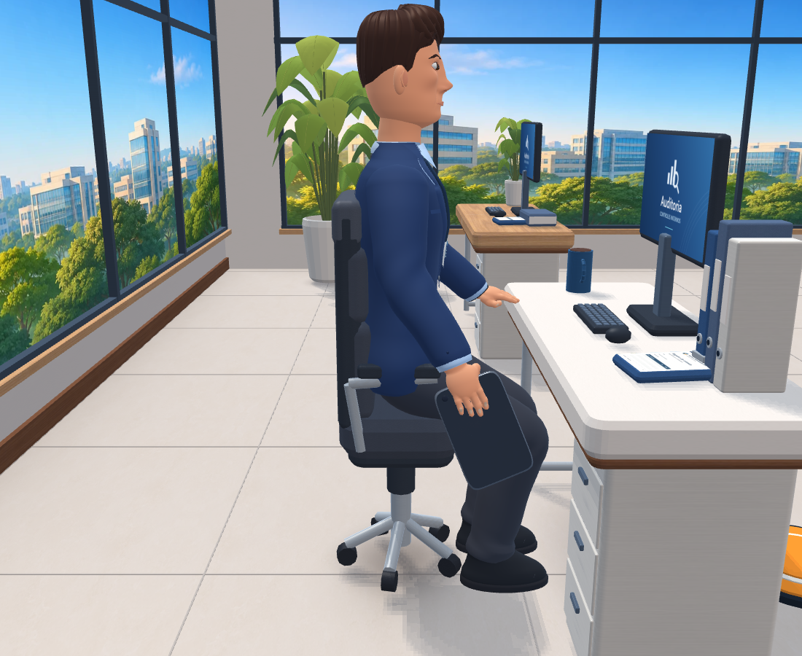
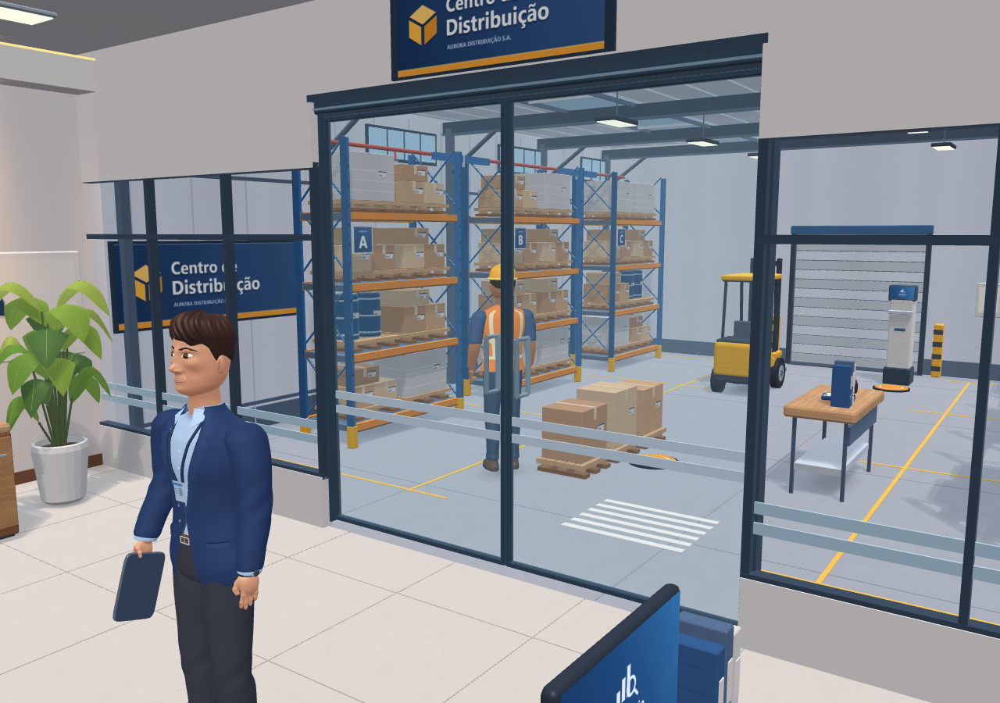

# Cadeiras e porta de vidro

Implementação integrada à `main` na Versão Alfa 0.3.5. A ramificação `codex/teste-nova-implementacao` foi preservada.

| Comando | Ação |
| --- | --- |
| Q | Conversar e executar os procedimentos da missão |
| E em contato com uma cadeira | Posicionar-se e sentar |
| E sentado | Levantar e sair para uma posição livre |
| E diante da porta | Alternar abertura e fechamento |
| Arrastar a cena ou usar os controles de giro | Girar a câmera, inclusive sentado |

Os botões de ação na tela oferecem as mesmas funções por toque. Os cartões de missão e de cadeira/porta podem aparecer juntos, identificados por Q e E. Durante uma transição, o botão indica Posicionando, Sentando, Levantando ou Saindo e aguarda a conclusão.

## Cadeiras

As oito cadeiras do escritório são utilizáveis pelo jogador. A cadeira atrás da mesa do galpão usa o mesmo modelo, fica voltada para a bancada e está ocupada pelo funcionário, sentado com as mãos junto aos documentos e o olhar voltado para o trabalho. Ele não oferece diálogo ou interação; a cadeira ocupada não oferece a ação de sentar. A seleção das cadeiras livres aceita contato de qualquer lado, independentemente da direção para a qual o auditor está olhando. Se duas estiverem ao alcance do contato, a mais próxima é selecionada.

O auditor primeiro caminha até a frente do assento e se orienta; só depois dobra os joelhos e abaixa o corpo. A pose usa o esqueleto do próprio modelo, com pés apoiados e calça no topo da almofada. O tablet permanece preso à mão direita, ao lado da cadeira, e a mão esquerda repousa pouco acima da mesa. Ao levantar, o auditor retorna pelo trajeto de aproximação a uma posição livre.



Enquanto estiver sentado ou em transição, comandos de caminhada e ações da missão ficam suspensos. A câmera continua orbitável. O movimento normal aprovado da Alfa 0.2 foi preservado.

## Porta

A porta tem duas folhas deslizantes, caixilho grafite, vidro azul discreto e faixas foscas. A transparência usa quatro triângulos, sem refração ou reflexos em tempo real.



Somente E ou o botão correspondente inicia a abertura ou o fechamento. Aproximar-se não aciona a porta. Se o auditor obstruir um fechamento já solicitado, as folhas pausam sem inverter o comando; o fechamento continua quando a passagem fica livre. Pressionar E novamente permite inverter o comando explicitamente.

As folhas bloqueiam a caminhada conforme sua posição. A câmera pode atravessá-las: vidro, puxadores e caixilho da peça tocada ficam temporariamente invisíveis e reaparecem ao sair. A porta não provoca zoom. As paredes mantêm sua proteção habitual da câmera.

## Validação

```sh
node --test tests/personagens.test.cjs tests/camera.test.cjs tests/interacoes.test.cjs tests/sentar-pose.test.cjs tests/porta-render.test.cjs
python tests/interacoes-runtime.py
python tests/interacoes-runtime.py --engine webkit --case celular
python tests/interface-mobile.py --case celular --case tablet-paisagem --case computador
```

Os testes de interação cobrem as oito cadeiras livres e o bloqueio da cadeira ocupada, escolha por proximidade, alinhamento antes da pose, saída livre, comandos Q/E, bloqueio da missão sentado, porta manual e colisões. Os testes geométricos conferem pés, assento, mão/mesa e ancoragem do tablet. A conferência WebGL usa Edge em computador/celular/tablet emulados e WebKit em celular emulado; não representa medição em aparelho físico.
