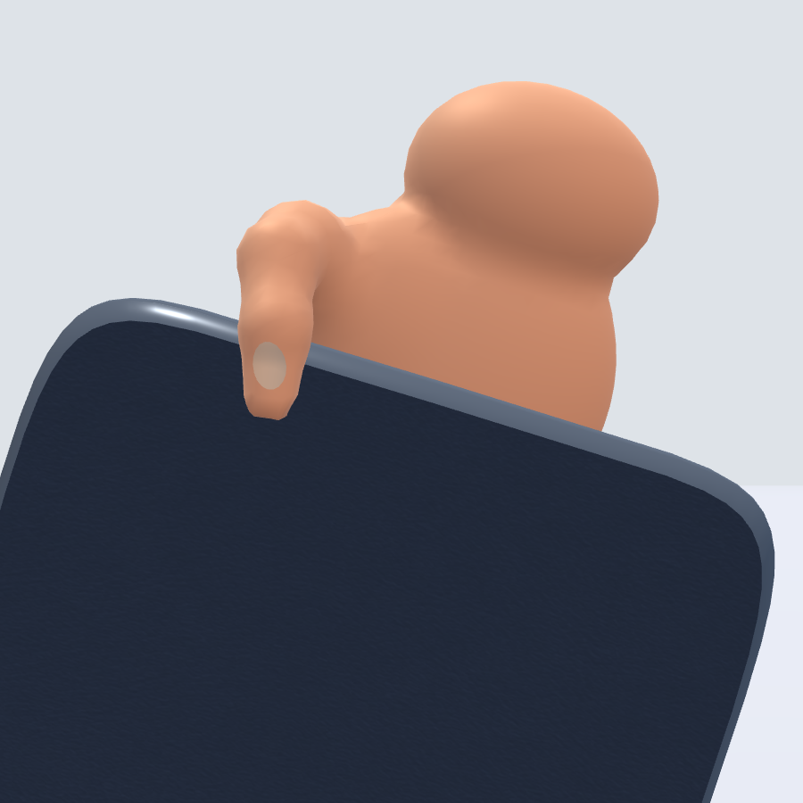
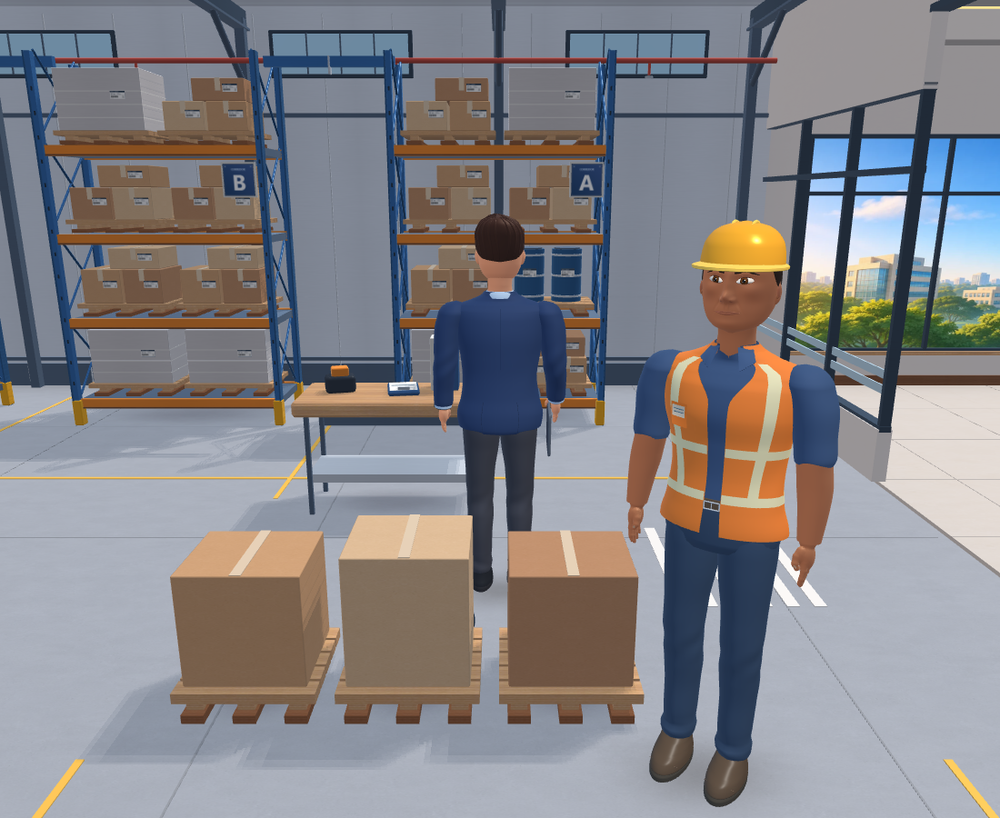

# Revisão da câmera e do encaixe do polegar

## Mão direita

O polegar agora nasce na base da palma, abaixo do punho. A articulação se curva sobre a borda superior do tablet e a ponta se apoia na face interna. O tablet foi rebaixado para acompanhar esse apoio; a mão e o aparelho continuam presos ao mesmo antebraço durante a caminhada. A pele continua sendo uma superfície única e fechada.



Esta captura de inspeção usa a malha do jogo com o restante do personagem oculto para mostrar o contato. Não altera o enquadramento da exploração.

## Câmera de exploração

- Apenas as paredes externas e as divisórias limitam a distância da câmera. O vão entre escritório e galpão permanece livre.
- Mesas, cadeiras, estantes, plantas, equipamentos e outros personagens não provocam zoom nem ocultam o auditor.
- Ao tocar o volume da câmera ou seu plano de recorte, o objeto atravessado fica invisível por inteiro. Ele reaparece ao sair; uma pequena margem evita cintilação na borda. Objetos apenas no caminho entre câmera e auditor continuam visíveis.
- O auditor é ocultado somente quando o zoom causado pela parede fica muito próximo. Reaparece ao recuperar distância. A entrevista conserva seu enquadramento próprio e o rosto do gestor livre.
- As colisões da caminhada não mudaram: o auditor continua impedido de atravessar móveis, equipamentos e pessoas.



O renderizador mantém as malhas na GPU. Quando não há objetos atravessados, o cenário conserva uma chamada de desenho; havendo ocultação, desenha apenas os intervalos de triângulos visíveis. A geometria de cadeiras e plantas é independente da mesa ou do armário em que foi criada.

## Validação

```sh
node --test tests/personagens.test.cjs tests/camera.test.cjs
python tests/interface-mobile.py --case celular --case tablet-paisagem --case computador
```

Os 21 casos do elenco incluem continuidade da mão, polegar abaixo do punho, ausência de pele dentro do tablet, ancoragem e animações. Os 9 casos da câmera verificam 2.160 vistas junto a paredes, divisórias e passagem aberta, ausência de zoom provocado por objetos, ocultação/restauração do jogador apenas com zoom muito próximo, colisões da caminhada, limites das malhas, ocultação/restauração de móveis e personagens e desenho independente das paredes.

As capturas foram feitas com WebGL real no Edge. No Edge e no WebKit, os 34 objetos do cenário foram ocultados e restaurados sem erros de WebGL; também foram conferidos o zoom junto às paredes e a passagem da câmera pelo gestor e pelo operador, mantendo o auditor visível. A regressão de interface passou em celular de 390 × 844 e 375 × 667, tablet e computador. A validação em celulares usa emulação; não representa um teste em aparelho físico.
