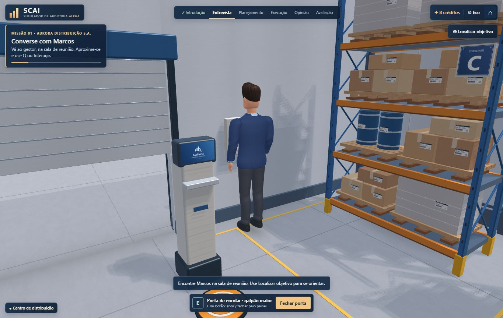
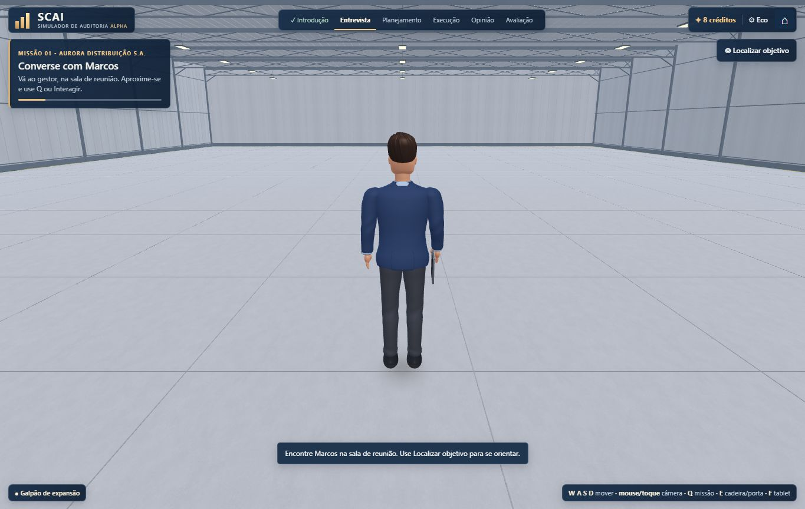

# Galpão de expansão

Recurso da Versão Alfa 0.5 na ramificação `codex/teste-nova-implementacao`.

Aproxime-se do painel ao lado da porta metálica e use **E**, ou toque em **Abrir porta**. Use novamente para fechar. O painel do outro lado faz as mesmas duas ações. A proximidade não aciona a porta. Se o vão estiver ocupado, o fechamento solicitado pausa até a passagem ficar livre.



O galpão foi deslocado lateralmente para alinhar sua lateral ao prédio existente e liberar a vista das janelas, mantendo o portão no lugar. A base da parede recebeu rodapé e vedação de concreto na junção com o piso; os dois caixilhos altos do galpão menor ficam inteiramente atrás da parede do portão.

O galpão tem 80 × 55,34 unidades, teto a 10,8 unidades, paredes fechadas, treliças, luminárias e piso de concreto igual ao galpão anterior. O piso permanece livre de móveis e cargas; os pilares ficam junto às paredes. A empilhadeira existente permanece estática, para uma implementação futura.



A porta recolhe as lâminas na caixa superior; não atravessa o teto. Câmera e caminhada respeitam as paredes dos dois ambientes e o vão. O cenário externo das janelas foi afastado para não intersectar o novo interior, preservando sua cobertura.

Validação: 37 testes automatizados e passagem nos dois sentidos no Edge em computador/celular emulados, com comandos E/toque, ambos os painéis, fechamento e reabertura, limites do galpão e câmera. Sem erros JavaScript/WebGL. A emulação não mede o desempenho em aparelho físico.

```sh
node --test tests/galpao.test.cjs tests/camera.test.cjs tests/interacoes.test.cjs tests/porta-render.test.cjs tests/janelas.test.cjs
python tests/galpao-runtime.py
```
