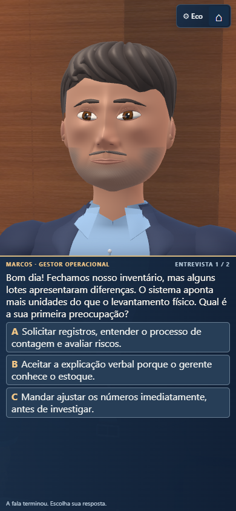
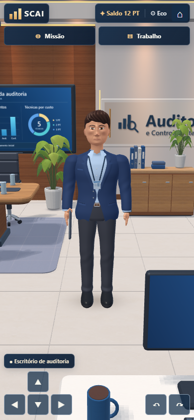

# Interface em celulares

O diálogo ocupa os 50% inferiores da tela nos celulares. Computadores e tablets mantêm a faixa de 25%. Pergunta e respostas continuam com fonte de 16 px; a fala segue a 30 caracteres por segundo e as alternativas aparecem quando ela termina.



Na orientação vertical, a pergunta fica fixa acima das alternativas. Na horizontal, pergunta e alternativas ficam lado a lado. Em telas muito pequenas, somente a lista de alternativas precisa rolar, mantendo a pergunta à vista. O enquadramento mantém o rosto de Marcos acima do diálogo.

## Painéis da missão

No celular, Missão e Trabalho começam recolhidos nos botões do topo. Tocar em um botão abre seu painel; tocar novamente o recolhe. Apenas um painel fica aberto por vez. O botão ×, o comando Recolher, Escape ou um toque fora do painel também o fecham.



Localizar objetivo recolhe o painel para mostrar a direção indicada. Conversas e janelas de planejamento/relatório também recolhem os painéis. Os dados continuam atualizados quando eles são reabertos. Computador e tablet mantêm seus painéis habituais, sem esses botões adicionais.

Os sinais de dispositivo e o tamanho físico da tela em pixels CSS evitam aplicar o modo de celular a uma janela estreita do computador ou a um tablet em tela dividida. Tablets Android compactos e iPads também mantêm o modo de tablet.

## Controles por toque

Os botões de movimento e giro cancelam o gesto nativo de toque prolongado desde o início do contato, para impedir o menu e sua possível vibração. Segurar continua acionando o controle; soltar ou cancelar o toque interrompe a ação. É possível caminhar e girar com dois dedos ao mesmo tempo. O botão F e os demais botões continuam aceitando toques normais.

O toque prolongado e o uso de dois dedos foram conferidos em celular e tablet emulados no Edge. A vibração física requer conferência em um aparelho real.

## Rosto do gestor

As linhas de envelhecimento em relevo foram removidas da testa, da região sob os olhos e do entorno da boca de Marcos. A barba e os fios grisalhos continuam identificando o personagem; o restante da pele permanece suave.

## Validação

A regressão de interface percorre as duas perguntas, abertura e recolhimento dos painéis, planejamento e relatório. Confere 50%/25%, fonte de 16 px, leitura da pergunta durante a rolagem das alternativas, rosto fora do diálogo, ausência de seleção de texto por CSS, painel de trabalho atualizado e ausência de erros de WebGL. Os perfis incluem celular em retrato/paisagem, 375 × 667, 320 × 568, tablet em retrato/paisagem, tablet compacto, tela dividida e computador largo/estreito.

Com Playwright disponível no ambiente de desenvolvimento:

```sh
python tests/interface-mobile.py
python tests/interface-mobile.py --engine webkit --case celular --case tablet-paisagem
node --test tests/personagens.test.cjs
```

O teste usa o Edge instalado no Windows ou o Chromium do Playwright. A variável `SCAI_BROWSER` permite indicar outro executável Chromium. `--capture` atualiza as duas capturas desta página. O jogo continua sem dependências de Playwright ou Python para funcionar.
