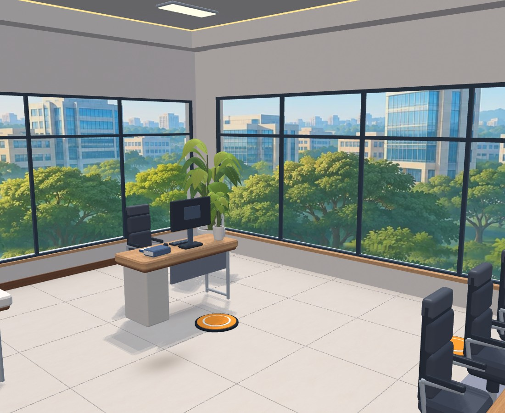
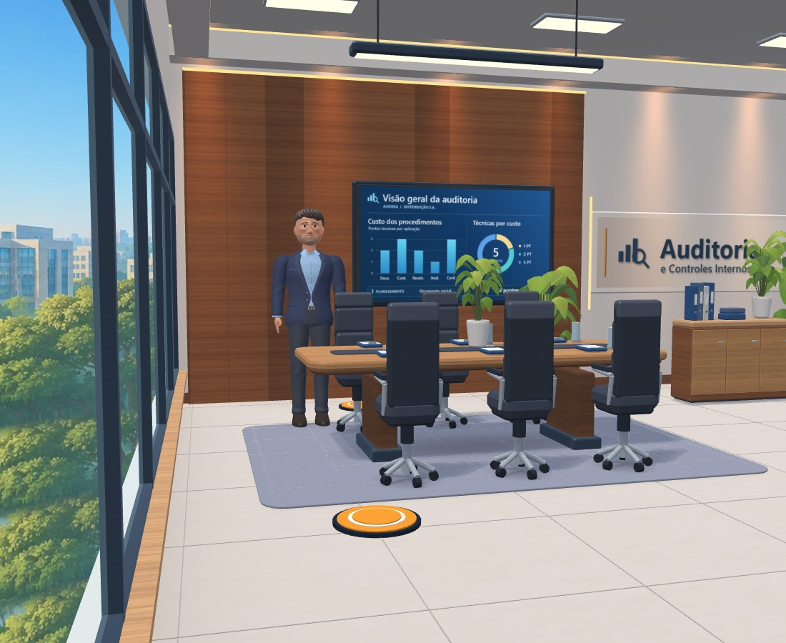

# Janelas de vidro e vista com profundidade

Implementação da Versão Alfa 0.4.1 na ramificação `codex/teste-nova-implementacao`, integrada à `main` com autorização do autor.

As duas fachadas do escritório têm aberturas reais nas paredes, caixilhos e planos de vidro. As duas divisórias envidraçadas junto ao galpão também receberam vidro. Janelas e porta compartilham a mesma definição de cor, material e opacidade em `SCAILighting.glass`.



O panorama original foi reutilizado em uma cobertura curva fechada, com raio de 40 unidades, ao redor do prédio. Ao caminhar ou girar a câmera, os caixilhos próximos se deslocam em relação à paisagem distante. A cobertura inclui a parte inferior e os ângulos laterais junto ao vidro. As extremidades da fotografia usam sobreposição suave, e as regiões de vegetação preenchem a continuação inferior. O chão verde plano foi removido. A imagem usa uma textura separada com filtro linear para evitar emendas causadas pela amostragem do atlas.



O vidro usa composição transparente depois da cena opaca, com ordenação do fundo para a frente e teste de profundidade. Cada janela usa dois triângulos; a porta mantém seu material e sua animação. A câmera continua protegida pelos limites do prédio e pelas divisórias. Se um plano de vidro coincidir com a câmera, ele fica temporariamente oculto. O alcance de desenho passou a 90 unidades para incluir a vista distante.

## Validação

Passaram 69 testes de geometria, pose, interação, câmera e renderização, incluindo sete verificações de janelas: material compartilhado, vãos nas paredes, distância do panorama, cobertura fechada, paralaxe, composição das transparências e limites da câmera. A cobertura foi verificada em 120 direções junto às duas fachadas, incluindo cantos e vistas rasantes/para baixo. A composição do vidro também foi confirmada comparando pixels renderizados com e sem os planos transparentes.

As interações foram conferidas no Edge em computador/celular/tablet emulados e no WebKit em celular emulado. Houve inspeção visual das duas fachadas, da vista de perto e de longe, dos quatro ângulos rasantes e de posições reais do jogador junto às janelas, sem erros de WebGL. A região inferior do fundo foi conferida por leitura de pixels nos dois navegadores, com detalhes da vegetação e sem a antiga área de cor uniforme. A emulação não mede o desempenho em aparelho físico.

```sh
node --test tests/personagens.test.cjs tests/camera.test.cjs tests/interacoes.test.cjs tests/sentar-pose.test.cjs tests/porta-render.test.cjs tests/tablet.test.cjs tests/janelas.test.cjs
python tests/interacoes-runtime.py --case computador --case celular --case tablet
python tests/interacoes-runtime.py --engine webkit --case celular
```
