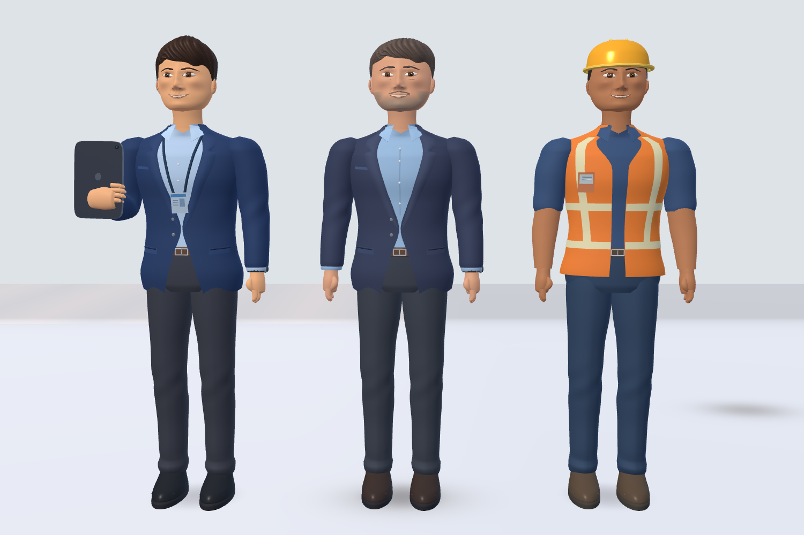

# Experimento visual dos personagens

Implementação em `codex/teste-nova-implementacao`, baseada na referência de auditor em estilo Clean Stylized 3D. O experimento mantém o elenco da fase Aurora: auditor, Marcos e operador. O resultado é uma interpretação estilizada em tempo real da referência.

## O que mudou

- Rosto com proporções revistas, ponte e asas do nariz esculpidas, maçãs do rosto, olhos amendoados, íris texturizada, lábios, dentes e sorriso.
- Cabelo com volume penteado, relevo de mechas e microtextura. Marcos conserva os fios grisalhos e a barba aparada; o operador conserva o capacete e o colete.
- Paletó e calças com superfícies contínuas nas articulações, pregas discretas, lapelas com dobra, bolsos, costuras e colarinho ajustado. Sapatos com acabamento de couro e cadarços; cinto com fivela retangular.
- Mãos com dedos, unhas e polegar; o auditor segura o tablet junto ao corpo com a mão e o objeto ligados ao mesmo antebraço.
- Deformação por dois ossos nos cotovelos, joelhos, quadril e pescoço. Mandíbula e lábio acompanham a fala; as pálpebras piscam durante a animação de repouso.
- Iluminação própria dos personagens em espaço linear, com resposta diferente para pele, cabelo, tecido, couro, metal e olhos. O cenário mantém a iluminação existente.

As capturas acima são renderizações WebGL dos modelos implementados. A primeira usa o escritório da fase e um enquadramento de inspeção, com o HUD oculto; a segunda reúne o elenco sobre um fundo neutro para comparação. As câmeras usadas nas capturas não modificam a câmera de exploração do jogo.

## Materiais

O [atlas do elenco](../assets/elenco-atlas.webp) contém oito superfícies: pele, lã azul, camisa azul clara, lã cinza, cabelo castanho, couro preto, couro marrom e íris castanha. `assets/elenco-materiais.js` incorpora a mesma imagem para permitir a abertura por arquivo local, sem depender de download ou CORS. O renderizador prepara a textura com mipmaps; detalhes mais finos perdem intensidade à distância para reduzir cintilação.

Foi usado o modo integrado da habilidade `imagegen`. A imagem gerada foi codificada em WebP para distribuição. Prompt utilizado:

> Use case: stylized-concept. Asset type: production albedo texture atlas for real-time Clean Stylized 3D human game characters. Create one perfectly rectangular 4-column by 2-row atlas, 8 equal square tiles, tightly aligned at x=25%,50%,75% and y=50%, no borders, no gutters, no labels, no text. Overall landscape 2:1. Each tile is a full flat orthographic material swatch, diffuse albedo only, no perspective, no shadows, no objects, no folds or lighting gradients. Upper row left to right: (1) subtly warm beige human facial skin, natural very fine pores and extremely subtle tonal variation, smooth sophisticated semi-realistic finish, no wrinkles or facial features, NOT leather; (2) deep navy blue fine tailored suit wool, very fine uniform high-end twill; (3) pale powder blue cotton shirt poplin, extremely fine delicate weave; (4) neutral dark charcoal grey tailored trouser wool, fine subtle weave. Lower row left to right: (5) dark chestnut brown hair fibers in softly curving parallel diagonal strands, restrained copper undertones, no scalp or silhouette; (6) very dark graphite black polished oxford shoe leather, extremely fine soft grain, flat diffuse not shiny highlights; (7) medium brown premium belt/watchband leather, fine smooth grain with subtle pores; (8) one centered straight-on amber brown human iris filling the square with radial fibers, dark brown limbal edge and a pure black circular pupil of 30% of iris diameter, detailed subtle gold/olive fibers, no eyelids, no sclera, no highlights or catchlights. Style: smooth sophisticated semi-realistic corporate character materials, refined and clean, not gritty or noisy. Consistent neutral light, no baked specular or glossy highlights anywhere. All material tiles except iris should tile seamlessly with their own opposite edges. This is a raw game texture sheet, never an illustration of a person or environment.

## Validação

`node --test tests/personagens.test.cjs` verifica nove casos: integridade das malhas e influências do esqueleto para cada personagem, poses finitas ao girar/caminhar/falar, apoio do pé durante o avanço, solas acima do chão e altura da postura/ancoragem do tablet. Os modelos usam índices de 16 bits no WebGL 1 e um desenho por personagem.

A fase foi aberta diretamente e pelo menu no Edge com WebGL real. A missão foi percorrida até o resultado aprovado, incluindo entrevista a 30 caracteres por segundo, feedback instantâneo, execução de testes fora do plano e cinco mudanças de plano sem criar créditos. Os três personagens foram conferidos de frente, de perfil e por trás; caminhada, fala e piscada foram renderizadas sem erro de WebGL. O layout móvel foi conferido com emulação, com fonte de 16 px e faixa de diálogo de 25% da altura.

A inicialização, a renderização e a exibição dos controles de toque também passaram no WebKit com emulação móvel de 430 × 932, sem erro de WebGL. A medição final no Edge ficou em aproximadamente 60 FPS a 1180 × 756, com Intel UHD Graphics neste computador.

O desempenho e a aparência em aparelhos físicos continuam sujeitos à GPU, resolução e navegador. A referência é um render de estúdio; este experimento usa geometria e iluminação interativas em WebGL 1 e deve ser avaliado visualmente nessa ramificação antes de integração.
